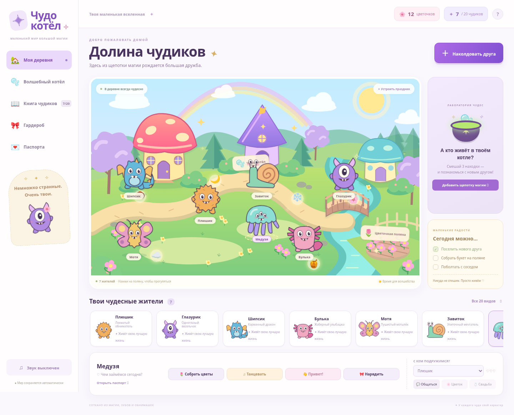

# Чудо-котёл · Долина чудиков

Яркая браузерная игра на русском. В волшебной деревне живут созданные игроком монстрики: они гуляют, собирают цветы, танцуют, общаются, влюбляются и играют свадьбы. Это один общий мир, без верхней панели с пронумерованными шагами.



## Играть

Откройте `index.html` в современном браузере или запустите локальный сервер:

```sh
python3 -m http.server 3000 --bind 0.0.0.0
```

`npm start` запускает тот же сервер. Для самой игры устанавливать зависимости не нужно. Для GitHub Pages выберите в Settings → Pages публикацию из ветки `main`, папку `/ (root)`: сборка не требуется.

## Что есть в игре

- 20 оригинальных векторных видов с разными силуэтами: пушистик, росточек, циклоп, дракон, аксолотль, облачко, медузка, гриб, кактус, летучий мышонок, кристальный крепыш, мотылёк, осьминожек, огонёк, йети, улитка, желейка, ушастик, колючий шарик и космический странник.
- 20 ингредиентов. Смешайте три разных находки в котле. Книга чудиков показывает точный рецепт каждого вида; любые другие сочетания тоже дают определённый вид независимо от порядка ингредиентов.
- Гардероб с цветами, шестью вариантами головных украшений и шестью вариантами аксессуаров. Имя, характер, родина, любимые вещи, дата рождения, друзья и романтические отношения отражаются в паспорте.
- До 30 жителей, включая несколько монстриков одного вида. Выберите жителя на поляне или в карточках, нажмите на свободную поляну — и он пойдёт туда. Жители также иногда сами гуляют и разговаривают.
- Сбор букета приносит три цветочка и случайный ингредиент. Светящиеся находки на карте собираются нажатием и появляются снова через 18 секунд. За три цветочка корзина пополняется двумя экземплярами каждого ингредиента.
- Чтобы начать историю любви, выберите соседа в панели управления и поболтайте. Один подаренный цветок даёт одно сердечко. При трёх сердечках можно открыть свадебное окно и подтвердить церемонию. Брак сохраняется в паспортах обоих; состоящие в браке монстрики могут дружить с другими, но романтические подарки предназначены своей паре.
- Праздники для всей деревни, танцы, прыжки, мигающие глаза, эмоции, реплики и необязательная озвучка средствами браузера. На телефоне переключатель звука есть в справке `?`. Для уменьшенной анимации учитываются настройки `prefers-reduced-motion`.

## Сохранение и ограничения

Мир, жители, одежда, ингредиенты и отношения сохраняются автоматически в `localStorage` этого браузера (`wonder-village-v2`). Старый сохранённый монстрик из первой версии переносится при первом открытии. Повреждённые данные безопасно заменяются начальным миром. При блокировке хранилища можно играть до закрытия вкладки, но сохранение не гарантируется.

Это локальная однопользовательская игра. Облачной синхронизации, аккаунтов, обмена мирами и мультиплеера пока нет. Русский голос зависит от устройства; все реплики доступны текстом. Шрифты Google Fonts необязательны — без сети используются системные. Игровая графика и логика находятся в репозитории, внешних API и секретов нет.

## Разработка и проверки

Node.js 18+ и Python 3. Зависимости нужны только для разработки:

```sh
npm ci --cache /tmp/monster-npm-cache
npm run check
npm test
npm run test:browser
npm run format:check
```

Браузерные тесты используют системный `/usr/bin/chromium`, если он есть. Иначе выполните `npx playwright install chromium` либо задайте `CHROMIUM_PATH`. Тесты автоматически запускают свой сервер на порту 4173 и закрывают его по завершении; для уже запущенного сервера задайте `GAME_URL`.

Проверяются все 20 рецептов через интерфейс, гардероб и имя, сбор цветов, знакомство, подарки и свадьба, восстановление мира, разные размеры экрана, миграция старого друга и работа при запрете сохранения. Проверки данных также проверяют комбинации всех видов, аксессуаров и эмоций.

`data.js` хранит виды, рецепты и предметы; `monster-art.js` рисует персонажей; `world.svg` содержит карту; `app.js` управляет состоянием и взаимодействиями; `style.css` отвечает за оформление и анимацию.
